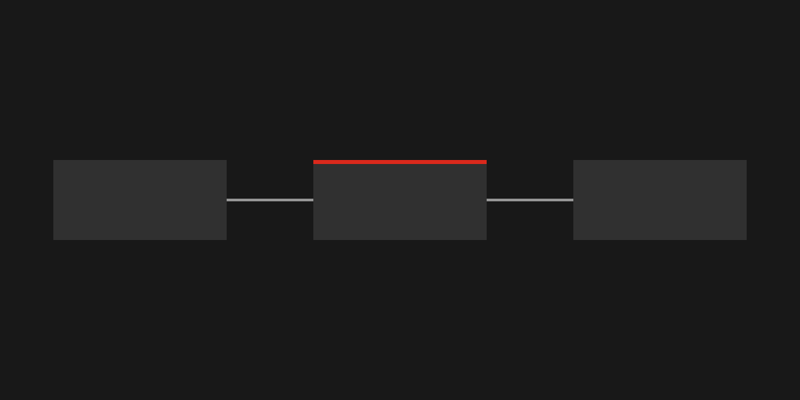

This site is plain HTML and CSS generated by [Astro](https://astro.build). Every page ships **zero JavaScript**.

## Architecture

Content lives in Markdown files. A build step validates them, renders pages, and GitHub Actions publishes the result.



### Content validation

Each collection has a schema, so a missing title fails the build instead of shipping a broken page:

```ts
export const postSchema = z.object({ title: z.string().min(1), description: z.string().min(1), pubDate: z.coerce.date() });
```

## Design

> Sharp corners, one red, and a lot of black.

The design tokens come from a `DESIGN.md` file. Long links still wrap on small screens: https://example.com/a/really/long/path/that/keeps/going/and/going/without/any/natural/break/points/to/test/wrapping

- Near-black canvas
- Rosso Corsa for primary actions only
- Inter for all text
